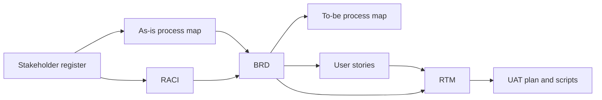

# Guide: how to use these templates

This is a short guide to the order I usually work in, how the documents link together, and what changes between Waterfall and Agile delivery.

## 1. The usual order



1. **Stakeholder register.** Find out who is involved before you book workshops. The register tells you who to invite and who must approve.
2. **RACI.** Agree who signs off what early. It saves arguments at the end.
3. **As-is process map.** Walk through the current process with the people who do it. Log every pain point with evidence.
4. **BRD.** Turn the problem, objectives and pain points into business requirements, with priorities.
5. **To-be process map.** Show how the process will work after the change, and which pain points each change addresses.
6. **User stories.** Break the requirements into items the team can build and test.
7. **RTM.** Link every requirement to its stories and tests. Keep it up to date as things change.
8. **UAT plan and scripts.** Write test scripts from the acceptance criteria, then run them with business users.

## 2. How the IDs link up

Every document uses the same IDs, so anyone can trace a line from the business need to the test result:

| Prefix | Item | Defined in |
|---|---|---|
| S | Stakeholder | Stakeholder register |
| P | Pain point | Process map |
| OBJ | Business objective | BRD |
| BR | Business requirement | BRD |
| NFR | Non-functional requirement | BRD |
| EP / US | Epic / user story | Backlog |
| TC | Test case | UAT script |

## 3. Waterfall vs Agile

The thinking is the same; what changes is how much is written up front and when it's signed off.

| Document | Waterfall | Agile |
|---|---|---|
| Stakeholder register / RACI | Full version at the start | Lighter version at the start, updated each quarter or release |
| Process maps | As-is and to-be, signed off before design | As-is up front; to-be refined as features are built |
| BRD | Full, baselined, change-controlled | Short version (problem, objectives, scope, high-level requirements) that guides the backlog |
| User stories | Often replaced by an FRD / functional spec | Main requirements format; refined each sprint |
| RTM | Formal, reviewed at each stage gate | Often kept in the backlog tool (requirement → epic → story → test) |
| UAT | One phase before go-live | Acceptance in each sprint, plus a short end-to-end UAT before release |

## 4. Common mistakes

- **Writing solutions instead of needs.** "Add a dropdown" is a design decision. Ask "why?" until you reach the business need.
- **Requirements nobody can test.** If you can't write a pass/fail acceptance criterion, the requirement isn't clear yet.
- **More than one Accountable.** If two people own a decision, nobody does.
- **Mapping the process as it should work.** Map what actually happens, including the workarounds.
- **Letting the RTM go stale.** An out-of-date RTM gives false confidence at go/no-go.
- **Leaving data protection to the end.** If personal data is involved, bring in the data protection lead at the start.

## 5. Tools

These templates are plain Markdown, so they work in GitHub, Confluence (paste as Markdown), or can be converted to Word with Pandoc:

```bash
pandoc templates/03-brd.md -o brd.docx
```

Mermaid diagrams render on GitHub and in most Markdown editors. For formal BPMN, redraw them in Visio, Lucidchart or draw.io.
