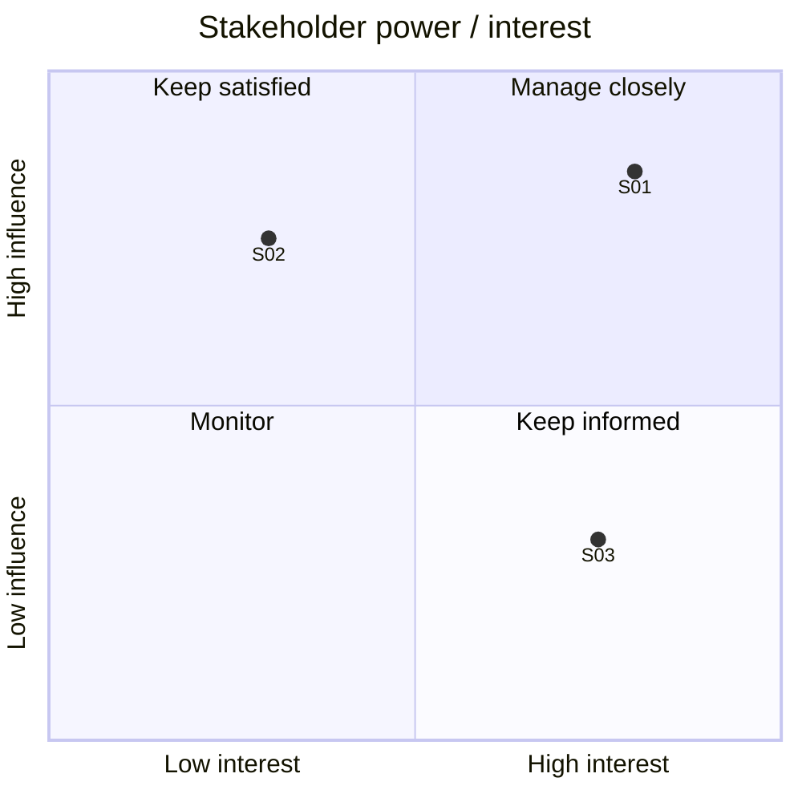

# Stakeholder Register and Map

**Project:** _name_
**Version:** 0.1 | **Owner:** _BA name_ | **Last updated:** _date_

## 1. Stakeholder register

List everyone who is affected by the change, can influence it, or has to approve it. Include groups (e.g. "store colleagues") as well as named people.

| ID | Stakeholder / group | Role | Interest in the change | Influence (H/M/L) | Interest (H/M/L) | Current view (Supportive / Neutral / Resistant) | Key concerns | Engagement approach | Contact frequency |
|---|---|---|---|---|---|---|---|---|---|
| S01 | | | | | | | | | |
| S02 | | | | | | | | | |
| S03 | | | | | | | | | |

**Tips**
- "Interest in the change" is what they gain or lose, in their words if you can get it.
- Record the *current* view, not the one you hope for. Update it after each workshop.
- Note any stakeholder who can stop the project (budget holder, data protection, legal). They're easy to miss.

## 2. Power / interest map

Place each stakeholder ID in the right quadrant.

| Quadrant | What it means in practice |
|---|---|
| **Manage closely** (high influence, high interest) | Involve in workshops and decisions; review drafts with them first |
| **Keep satisfied** (high influence, low interest) | Short updates focused on cost, risk and timescales; consult before key decisions |
| **Keep informed** (low influence, high interest) | Regular updates, demos, invite feedback; often the end users |
| **Monitor** (low influence, low interest) | Light-touch updates; check whether their position changes |

## 3. Communication plan

| Stakeholder / group | What they need to know | Format | Frequency | Owner |
|---|---|---|---|---|
| | | e.g. steering meeting, email update, demo | | |
