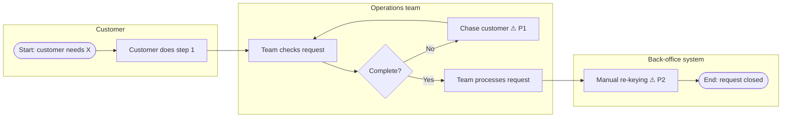
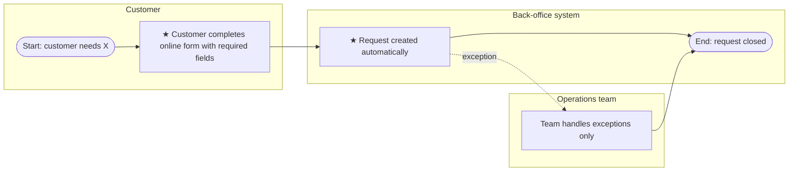

# Process Map (As-Is / To-Be)

**Process:** _name_
**Version:** 0.1 | **Owner:** _BA name_ | **Last updated:** _date_
**Mapped with:** _who you walked through it with, and when_

## 1. Process summary

| Item | Detail |
|---|---|
| Trigger | What starts the process |
| End point | What "done" looks like |
| Actors | Roles and systems involved |
| Volume | e.g. cases per week |
| Current cycle time | Start to end, with source |

## 2. As-is process

Use one subgraph per lane (role or system). Mark pain points with a ⚠ and a reference to the log below.

## 3. Pain-point log

| ID | Step | Pain point | Evidence | Impact | Idea for the to-be |
|---|---|---|---|---|---|
| P1 | | | e.g. 30% of cases need a chase (sample of 50) | | |
| P2 | | | | | |

## 4. To-be process

Show the same lanes so the changes are easy to compare. Mark new or changed steps with ★.

## 5. Change summary

| Step | As-is | To-be | Pain point addressed | Requirement IDs |
|---|---|---|---|---|
| | | | P1 | BR-01 |

## Notes on notation

Mermaid flowcharts are used so the maps live in the repo and show changes in version history. For formal sign-off, the same map can be redrawn in BPMN 2.0 (Visio, Lucidchart or draw.io), using pools/lanes for actors, rounded tasks, diamond gateways and circle start/end events.
